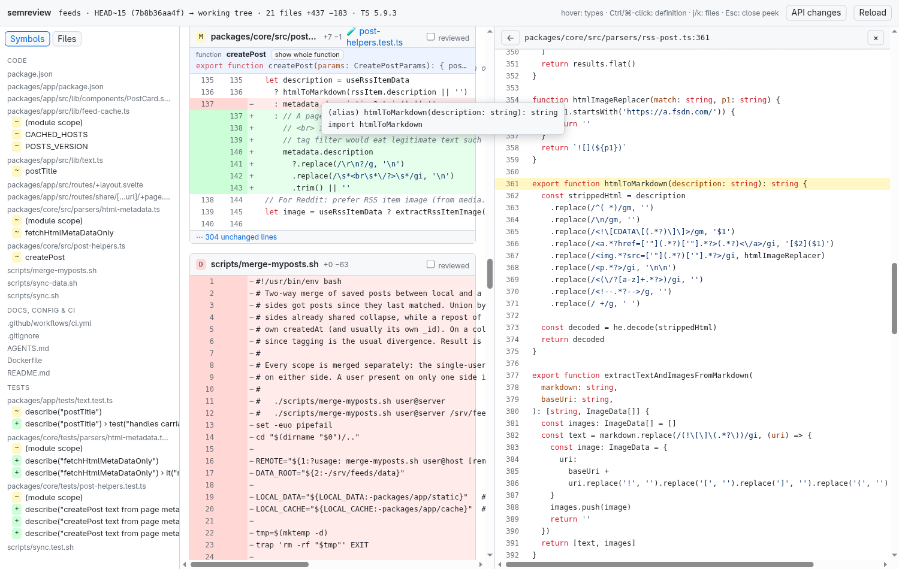

# semreview

Review a TypeScript/JavaScript branch by symbol, not by line: every hunk shows the function it is in, the
sidebar lists changed functions instead of files, hover shows types, Ctrl/⌘-click opens the definition next to
the diff, tests go last, and "API changes" compares exported signatures between base and head.



```sh
cd path/to/repo
node ~/Projects/semreview/server.mjs            # base = origin/HEAD|main|master, head = working tree
node ~/Projects/semreview/server.mjs main --head feature/x --port 4747
```

Uses the repo's own `typescript` package (no install for semreview itself; Node ≥ 22). Optional
`.semreview.json` in the repo root overrides groups and hidden files (see `DEFAULT_CONFIG` in `server.mjs`).

Self-check: `node test.mjs` (set `TS_DIR` to a `node_modules/typescript` directory).

Background, research and roadmap: [PLAN.md](PLAN.md).
